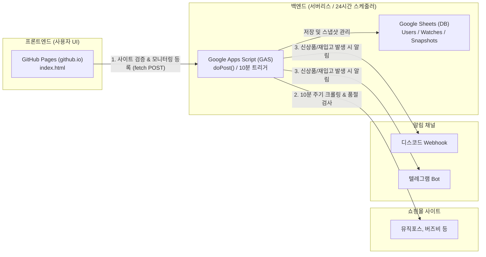

# 🎸 Alert Your Item (다중 쇼핑몰 신상품 & 재입고 모니터링 시스템)

악기 쇼핑몰(뮤직포스, 버즈비, 프리버드 등) 및 일반 쇼핑몰에서 원하는 모델의 **신규 등록(NEW)** 및 **품절 해제/재입고(RESTOCK)**를 감지하여 디스코드 또는 텔레그램으로 즉시 알림을 발송하는 모니터링 시스템입니다.

GitHub Pages(`github.io`) 프론트엔드와 서버비 0원의 Google Apps Script(GAS) 백엔드를 연동하여 완전 무료로 24시간 자동 동작합니다.

---

## 🌟 주요 기능

1. **한/영 키워드 자동 확장 및 조합 검증**
   - 로마자(i~x) ↔ 아라비아 숫자(1~10) 자동 변환 (`vintera iii` ↔ `빈테라 3`, `vintera3`, `vinteraiii`)
   - 띄어쓰기, 하이픈, 붙여쓰기 및 브랜드 사전(`fender` ↔ `펜더`, `stratocaster` ↔ `스트랫`) 지원
2. **2단계 품절(Sold Out) 정밀 판별**
   - **1단계**: 목록 화면의 품절 텍스트, 품절 이미지 배지(`icon_soldout.gif`), CSS 클래스 스캔
   - **2단계**: 키워드에 매칭된 상품에 한해 상품 상세 페이지 2차 검증(목록엔 숨겨진 품절 버튼 감지)
3. **상태 전이(State Transition) 기반 알림**
   - **신규 입고(NEW)**: 최초 발견 시 구매 가능한 상태일 때 발송
   - **재입고(RESTOCK)**: 품절(`isSoldOut: true`) 상태에서 구매 가능(`isSoldOut: false`)으로 전환될 때 발송
4. **디스코드 & 텔레그램 동시 알림**
   - Discord Webhook 및 Telegram Bot 지원

---

## 🏗️ 시스템 아키텍처



---

## 🚀 빠른 시작 가이드 (배포 및 설정)

### [1단계] Google Apps Script (GAS) 백엔드 설정 (소요 시간: 3분)

1. [Google 스프레드시트](https://sheets.new)로 이동하여 빈 문서를 하나 생성합니다. (문서 이름 예: `상품 모니터링 DB`)
2. 상단 메뉴에서 **[확장 프로그램]** → **[Apps Script]**를 클릭합니다.
3. 기본 생성된 `Code.gs`의 내용을 모두 지우고, 이 저장소의 [`gas_product_monitor.js`](gas_product_monitor.js) 전체 내용을 복사하여 붙여넣은 뒤 저장(`Ctrl + S`)합니다.
4. 상단 함수 선택 드롭다운에서 **`setupTrigger`**를 선택한 후 **[실행]** 버튼을 클릭합니다.
   - 최초 1회 실행 시 **"승인 필요"** 팝업이 나타납니다.
   - `고급` → `...으로 이동(안전하지 않음)` → `허용`을 클릭하여 권한을 승인합니다.
   - 실행 완료 시 **10분 주기 자동 크롤링 트리거**와 필요한 구글 시트 테이블(`Users`, `Watches`, `Snapshots`)이 자동 생성됩니다.
5. 우측 상단 파란색 **[배포]** 버튼 → **[새 배포]**를 클릭합니다.
   - **유형 선택**: 좌측 톱니바퀴 아이콘 클릭 후 **`웹 앱(Web App)`** 선택
   - **설명**: `v1` (자유롭게 입력)
   - **다음 사용자로 실행**: `나(Me)` (기본값)
   - **액세스 권한이 있는 사용자**: **`모든 사용자(Anyone)`** ⚠️ **(반드시 Anyone으로 선택해야 GitHub Pages에서 API 호출 가능)**
6. **[배포]** 버튼을 누르고 생성된 **웹 앱 URL**(`https://script.google.com/macros/s/.../exec`)을 복사해 둡니다.

---

### [2단계] GitHub Pages (`github.io`) 프론트엔드 배포

1. GitHub 저장소 상단 탭에서 **[Settings]** → 좌측 메뉴 **[Pages]**로 이동합니다.
2. **Build and deployment** 섹션 설정:
   - **Source**: `Deploy from a branch`
   - **Branch**: `main` 브랜치 선택, 폴더는 `/ (root)` 선택 후 **[Save]** 클릭
3. 약 1~2분 후 페이지 상단에 배포된 URL이 표시됩니다:  
   👉 **`https://choise-hun.github.io/alert_your_item/`**

---

### [3단계] 모니터링 등록 및 사용 방법

1. 배포된 GitHub Pages(`https://choise-hun.github.io/alert_your_item/`)에 접속합니다.
2. 화면 상단의 **⚙️ Google Apps Script (GAS) 웹앱 URL** 입력창에 1단계 6번에서 복사한 **GAS 웹앱 URL**을 붙여넣고 **[저장]**을 누릅니다. (브라우저 로컬 저장소에 안전하게 보관됩니다.)
3. **유저 정보 & 알림 웹훅 입력**:
   - 디스코드 웹훅 URL 또는 텔레그램(봇 토큰 + Chat ID)을 입력하고 **[🔔 웹훅 테스트 발송]**으로 정상 작동 여부를 확인합니다.
4. **상품 키워드 입력**:
   - 영문 및 한글 키워드를 입력하면 하단 태그에 파생 검색 조합이 실시간으로 자동 생성됩니다.
5. **모니터링 대상 쇼핑몰 등록**:
   - 💡 **등록 팁**: 쇼핑몰 메인 주소(`https://musicforce.co.kr`) 대신 **브랜드 카테고리 URL** 또는 **검색 결과 페이지 URL**(예: `https://.../product/search.html?keyword=jaguar`)을 입력합니다.
   - **[등록]** 버튼을 누르면 해당 사이트가 정적 크롤링이 가능한지 즉시 테스트 검증을 거친 후 목록에 추가됩니다.
6. 하단 **[🚀 모니터링 작업 최종 등록 및 첫 스캔 시작]** 버튼을 클릭합니다.
   - 구글 시트에 규칙이 저장되고 첫 번째 스캔이 즉시 실행됩니다.
   - 이후에는 GAS의 10분 주기 스케줄러가 백그라운드에서 자동으로 감시합니다.

---

## 🖥️ (대안) 홈서버 Node.js 방식 (`node_product_monitor.js`)

쇼핑몰에서 클라우드(Google IP) 대역을 차단하거나 1~3분의 더 빠른 주기로 감시하고 싶은 경우, 가정용 PC나 라즈베리파이 등 홈서버에서 Node.js 스크립트를 단독 실행할 수 있습니다.

```bash
# 1. 패키지 설치
npm init -y
npm install express axios cheerio iconv-lite node-cron

# 2. 서버 실행
node node_product_monitor.js

# 3. 브라우저 접속
# http://localhost:3000
```
- 데이터는 로컬 `monitor_db.json` 파일에 저장되며 5분 주기로 자동 크롤링됩니다.

---

## 📁 저장소 파일 구성

| 파일명 | 설명 |
| --- | --- |
| `index.html` | GitHub Pages 배포용 웹 UI (GAS 연동 URL 관리 및 크롤링 등록 인터페이스) |
| `gas_product_monitor.js` | Google Apps Script 소스코드 (서버리스 크롤러 + 시트 DB 연동 + 웹앱 API) |
| `node_product_monitor.js` | 로컬/홈서버 구동용 Node.js 백엔드 및 모니터링 서버 |
| `설계.md` | 품절 판별 2단계 알고리즘 및 호스팅 방식별 설계 사양서 |

---

## 📄 라이선스
MIT License
